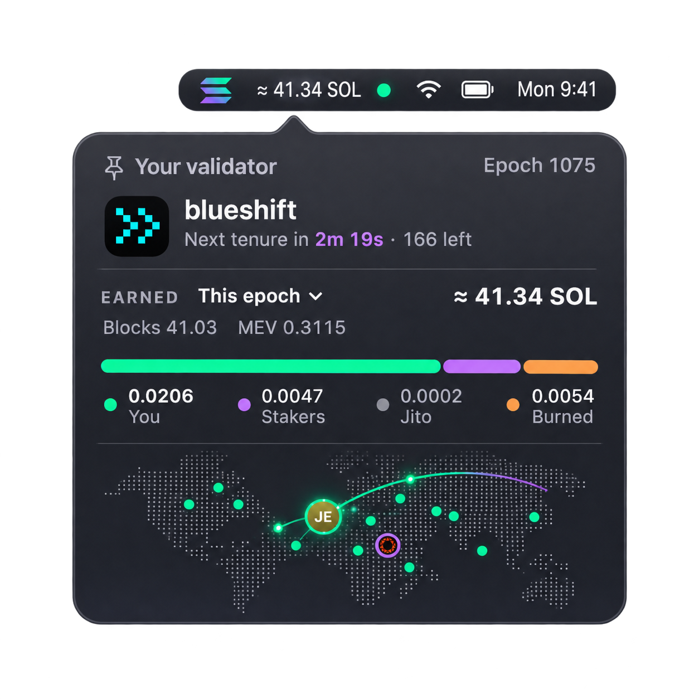

<div align="center">
  
</div>

<p align="center">
  <a href="https://github.com/lgalabru/sonata/releases/latest"></a>
  <a href="https://github.com/lgalabru/sonata/actions/workflows/release.yml"></a>
  
  
  
  <a href="LICENSE"></a>
</p>

<p align="center">
  <b>The Solana leader schedule, live in your menu bar.<br>
  Pin your validator: see when it leads next, and what every tenure earned.</b>
</p>

<p align="center">
  <a href="#install">Install</a> ·
  <a href="#key-features">Features</a> ·
  <a href="docs/HOW-IT-WORKS.md">How it works</a> ·
  <a href="#development">Development</a>
</p>

---

Sonata follows the leader schedule as it plays: who's producing blocks right now, who's next,
and where they are on the map. Pin your validator, and the menu bar becomes a countdown to
your next tenure, with what you've earned beneath it.

```
◎ 00:42
≈◎44.52
```

## Key features

### 📍 Your next tenure, to the second

Pin an identity or vote account in Settings. The menu bar counts down to your next leader
window (`mm:ss`, or `hh:mm:ss` when it's further off) and shows which slot you're on while
you lead. Slot times are measured from the network, not assumed.

### 💸 What each tenure earned, and who got it

When a tenure ends, Sonata reads its blocks and does the maths: block rewards (priority fees
plus the unburned half of base fees), Jito tips, user transactions, skipped slots and what
they likely cost. Then the split: what you kept, what your stakers get after your MEV
commission, Jito's fee, and the burn. A notification tells you as soon as it's in.

### 📈 Earnings over the period you choose

Last tenure, this epoch, the last 7 or 30 days, or this month: pick one and the menu bar
shows it. Block rewards, MEV commission and inflation commission, with vote costs apart.
Completed epochs come from [Trillium](https://trillium.so); the current one Sonata sums from
your own blocks, each read once and cached.

### 🗺️ The leader schedule on a map

Every leader as a dot on a dithered world map, sized by its share of slots. The camera
follows the current leader at 9×, a ring fills as its slots are produced, and arcs lead to
the next leaders. Validators wear their own icons, published on-chain.

### 🖥️ On your desktop, too

The same live map as a widget-style card beneath your windows. Drag it anywhere; it follows
every leader as the schedule plays.

### 🔌 Your RPC, your data

Mainnet, devnet, testnet or your own RPC. Schedules, names, icons, locations and earnings are
cached on your Mac, and nothing is sent anywhere but the public sources listed in
[How it works](docs/HOW-IT-WORKS.md).

## Install

```sh
brew install --cask scarce/axel/sonata
```

Sonata lives in the menu bar: click the Solana mark for the panel, right-click it for
Settings. Every commit on `main` that passes CI is a release, so `brew upgrade --cask sonata`
always brings the newest build. Releases are universal (Apple silicon and Intel) and need
macOS 15 or later.

Or build it yourself with Swift 6.2 (Xcode 26 or later):

```sh
git clone https://github.com/lgalabru/sonata && cd sonata
make install    # builds Sonata.app and copies it into /Applications
```

The public mainnet RPC works out of the box. It allows only a few `getBlock` calls per
second, so the first pass over an epoch's blocks is slow; a private RPC (Settings → Network)
makes it a matter of minutes.

## Documentation

- [How it works](docs/HOW-IT-WORKS.md): every data source, the maths, and what's cached where
- [Third-party notices](THIRD-PARTY-NOTICES.md): map data, the Solana mark, and data attributions

## Development

```sh
make test       # unit tests: schedules, the slot clock, the map, rewards and earnings maths
make run        # builds build/Sonata.app and opens it
make ci         # what CI runs: build, tests, the universal bundle and a smoke test
```

Pull requests run [CI](.github/workflows/ci.yml) on macOS 26: a release build with warnings as
errors, the tests, a universal app bundle that's checked and launched, and the zipped app as
an artifact. Merges to `main` run [the release](.github/workflows/release.yml): the same
checks, then a signed (and, with Developer ID secrets, notarized) build with provenance
attestation, a GitHub release, and the cask in
[scarce/homebrew-axel](https://github.com/scarce/homebrew-axel) moved to it.

`Sources/SonataCore` holds the RPC, schedule, caching, rewards and earnings logic, with no UI;
`Sources/Sonata` is the app: the status item and panel (AppKit), and the SwiftUI cards, map,
desktop widget and settings. The binary renders itself for review:

```sh
build/Sonata.app/Contents/MacOS/Sonata --snapshot panel.png --dark        # panel and desktop widget
build/Sonata.app/Contents/MacOS/Sonata --settings-snapshot settings.png   # the Settings window
build/Sonata.app/Contents/MacOS/Sonata --menubar-snapshot menubar.png     # the menu bar readout
```

The look follows [topophany-bar](https://github.com/WhitenWhiten/topophany-bar)'s Native theme;
the land bitmap comes from [topophany](https://github.com/WhitenWhiten/topophany).

## License

[Apache-2.0](LICENSE)
